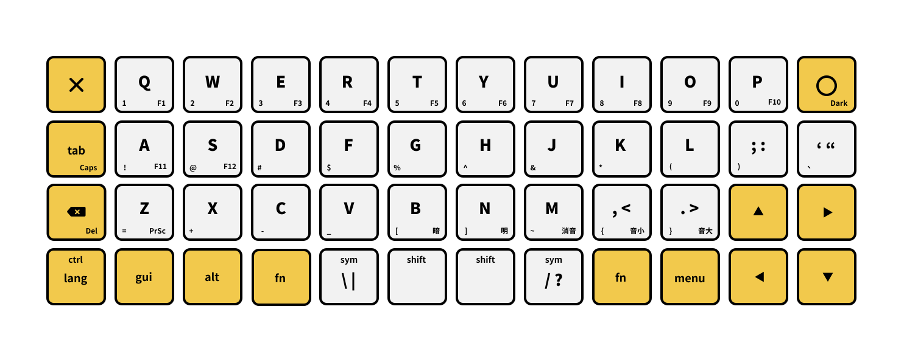
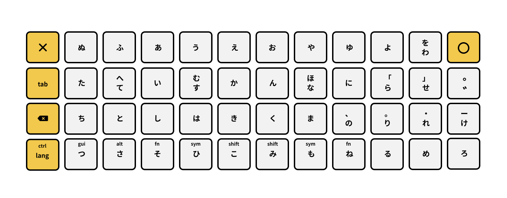
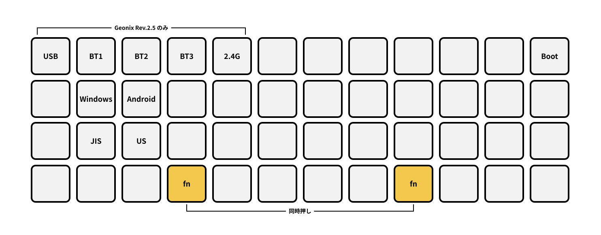

# Windmill
Windmill is a keymap for 40% keyboards.

このキー配列は、40%キーボード向けに作成したものです。

- 風車状のカーソル配置
- かな入力対応 (ほぼJISかな配列)
- SandS (Space and Shift)

詳しくは、以下をどうぞ。

- [キー配列 (↓)](#キー配列)
- [追加機能 (↓)](#追加機能)
- [導入方法](docs/install.md)
- [ファームウェアの作成](docs/build.md)

## 対応キーボード

| メーカー | キーボード | キーマップ |
| --- | --- | --- |
| Boardsource | [Technik](https://boardsource.xyz/store/5ffb9b01edd0447f8023fdb2) | [technik](firmware/technik/) |
| YMD | [YMD40](https://ymdkey.com/collections/40-mini-diy) | [ymd40](firmware/ymd40/) |
| Chosfox X Masro | [Geonix48](https://chosfox.com/ja/products/chosfox-x-masro-geonix48) | [minipeg48](firmware/minipeg48/) |
| Chosfox X Masro | [Geonix Rev.2.5](https://chosfox.com/products/chosfox-x-masro-geonix-rev-2-5) | [geonix41](firmware/geonix41/) |

📦ファームウェアのバイナリは[リリースページ](https://github.com/cognitom/windmill/releases)からダウンロードできます。

## キー配列

### 英字入力時

- ESC(✕)とEnter(○)が対称配置
- BSが最左列
- Fn, Sym, Shiftは、ホールド時に有効

### かな入力時

- 英語配列では修飾キーが並ぶ最下段も含めて、フルに4段を使う
- 「ほ」「へ」「む」「ー」のみシフト側へ
- 「こ」「み」同時押しでスペースキー
- GUI, Alt, Fn, Sym, Shiftは、ホールド時に有効

### 記号とファンクションキー

英字入力、かな入力ともに、最下段中央付近のキーをホールドすると、記号(Sym)またはファンクションキー(Fn)の入力になります。配置については英字配列の図で、各キーの添え字を参照。

かな/英数切り替えは、Ctrlキーのタップで行います。タップするたびに英数とかなが交互に切り替わります。

|  | L5 | L4| L3 | L2 | L1 | L0 | R0 | R1 | R2 |
|--|:--:|:--:|:--:|:--:|:--:|:--:|:--:|:--:|:--:|
| ホールド | Ctrl | GUI | Alt | Fn | Sym | Shift | Shift | Sym | Fn |
| タップ (英数) | かな | GUI | Alt | | \ | Space | Space | / | |
| タップ (かな) | 英数 | つ | さ | そ | ひ | こ | み | も | ね |

## 追加機能

### LED (Technik, YMD40, Geonix Rev2.5 のみ)

選択されたレイヤーが分かりやすいように、文字種別にライティングされます。

なお、デフォルトの状態はLEDが明るいので、暗い部屋で使う場合に光量を落として使えるダークモードを用意しました。使い方は、次の通り。

- <kbd>Fn</kbd> + <kbd>Enter</kbd> を押す

ダークモードを解除するには、もう一度上記のキーを押します。

### 対象OSの切り替え

各OSのIMEの差異を吸収するため、モードを切り替えることができます。<kbd>Fn</kbd>+<kbd>Fn</kbd> は、左右の Fn を両方押している間に押します。

| 独自キーコード | キー | 対象OS | 配列の認識 | IME |
|--|--|--|--|--|
| MY_WIN | <kbd>Fn</kbd>+<kbd>Fn</kbd>+<kbd>A</kbd> | Windows 11 | 日本語 (JIS) / English (US) | Microsof IME |
| MY_ANDR | <kbd>Fn</kbd>+<kbd>Fn</kbd>+<kbd>S</kbd> | Android | 日本語 (JIS) / English (US) | Gboard |

Android でかな/英数を切り替えるには、Android アプリ「Windmill 言語切り替え」が必要です。[cognitom/windmill-android のリリース](https://github.com/cognitom/windmill-android/releases)から入手できます ([導入方法](docs/install.md#android))。<kbd>変換</kbd>で日本語側の IME (既定は Gboard)、<kbd>無変換</kbd>で英語用の IME「Windmill 英語」へ切り替えます。

接続先の配列は <kbd>Fn</kbd>+<kbd>Fn</kbd>+<kbd>Z</kbd> (JIS、既定) / <kbd>Fn</kbd>+<kbd>Fn</kbd>+<kbd>X</kbd> (US) で、接続先ごとに選びます。

## v3での変更点

前バージョンから4年ほど経つ中で、Androidが「かな入力」にデフォルトで対応したりと、OS側の動きも大きいです。そのあたりに追従しつつ、実装をほぼ書き換えました。[CHANGES.md](CHANGES.md)にClaudeが詳しく書いているのでそちらをどうぞ。

- **変更**: かな切り替えをCtrlキーのタップ (英数とかなを交互に切り替え) に
- **追加**: [Android用 言語切替アプリ](https://github.com/cognitom/windmill-android)
- **廃止**: ローマ字エミュレーション
- **廃止**: NumPad

## ライセンス

Copyright (c) 2021-2026 Tsutomu Kawamura

このリポジトリのソースコードは **GPL-2.0-or-later** (GNU General Public License version 2, または任意のそれ以降のバージョン) で配布しています。全文は [LICENSE](LICENSE) を参照してください。

ビルドしたファームウェアは [QMK Firmware](https://github.com/qmk/qmk_firmware) (GPL-2.0-or-later) を含みます。また、各キーボードの定義ファイル (`keyboard.json` など) は以下をもとにしています。

- `technik`: QMKの [`boardsource/technik_o`](https://github.com/qmk/qmk_firmware/tree/master/keyboards/boardsource/technik_o)
- `ymd40`: QMKの [`ymdk/ymd40/v2`](https://github.com/qmk/qmk_firmware/tree/master/keyboards/ymdk/ymd40) (LEDの数を実機に合わせて変更)
- `minipeg48`: [sporewoh minipeg48](https://github.com/ChrisChrisLoLo/minipeg48) (本家QMKには未収録)
- `geonix41`: ベンダー (RDMCTMZT) 配布のソースをもとに移植 (本家QMKには未収録)

`geonix41` だけは無線・電源・LED制御にベンダー提供のクローズドソースなライブラリ
(`librdrcommon.a`) を使っており、これはこのリポジトリには含まれていません。
ビルド時に `scripts/fetch-vendor-blob.py` がベンダー配布物から取得します。
詳しくは [firmware/geonix41/readme.md](firmware/geonix41/readme.md) を参照してください。
