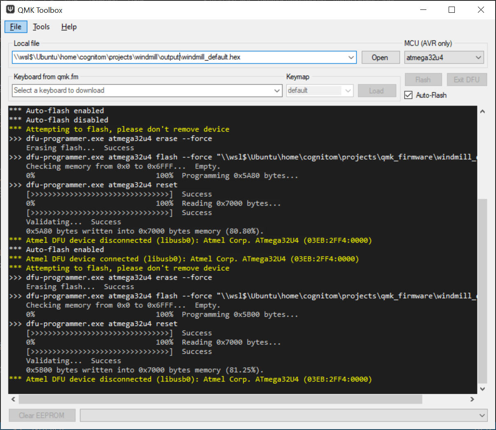

# 導入方法

## 準備

1. 対応キーボードを入手
2. PC/Macに[QMK Toolbox](https://github.com/qmk/qmk_toolbox/releases)をインストール
3. Windmillの[コンパイル済みファームウェア (windmill.hex)](https://github.com/cognitom/windmill/releases) をダウンロード

## ファームウェアの書き込み

### Technik / YMD40

1. QMK Toolboxからファームウェアファイルを指定
2. キーボードを接続
3. 左右の<kbd>Fn</kbd>を両方押しながら<kbd>Enter</kbd>で書き込み可能なモードに ※v3.1.0 以前のファームウェアが入っている場合は <kbd>Fn</kbd> + <kbd>P</kbd> ※あるいは、キーボード基板裏のリセットボタンを爪楊枝などで押す
4. `Flash`実行

※なお、Macについては未検証なので、調整が必要かもしれません。

### Android から書き込む

PC/Mac が無くても、Android のスマホから書き込めます。キーボードとは USB OTG (OTG ケーブルや変換アダプタ) でつなぎます。

#### Technik / YMD40 / Geonix48 (minipeg48)

1. スマホとキーボードを USB OTG でつなぐ
2. 左右の<kbd>Fn</kbd>を両方押しながら<kbd>Enter</kbd>で書き込み可能なモードに
3. Android の Chrome で [AVRFlashOnWeb](https://tmk.github.io/AVRFlashOnWeb/) を開き、ファームウェアファイル (`.hex`) を選んで書き込む

※minipeg48 で書き込めることを確かめています。

#### Geonix Rev.2.5 (geonix41)

ブートローダーが USB ドライブとして見えるので、ファイルをコピーするだけで書き込めます。

1. <kbd>Esc</kbd>を押しながら、スマホに USB OTG でつなぐ
2. 現れた USB ドライブへ、ファイルアプリで `windmill_geonix41.bin` をコピーする

## IMEの設定

キーボードレイアウトは日本語 (JIS) と英語 (US) のどちらでも構いません。キーボード側は既定で日本語 (JIS) 向けのキーを送るので、英語 (US) にした場合は、左右の<kbd>Fn</kbd>を両方押しながら<kbd>X</kbd>で US に合わせます ([接続先の配列の切り替え](../README.md#接続先の配列の切り替え))。IMEの入力方式として「かな入力」を選択しておきます。

※以前のバージョンで必要だった、ローマ字変換テーブルの置き換えなどは不要です。

### Android

Android では、対象OSを Android に切り替えた上で ([対象OSの切り替え](../README.md#対象osの切り替え))、[cognitom/windmill-android](https://github.com/cognitom/windmill-android) のアプリを入れて、ユーザー補助サービスを有効にしておきます。

かな/英数の切り替えで、キーボードはかなへは<kbd>変換</kbd>、英数へは<kbd>無変換</kbd>を送ります。Android 自体にはこれらのキーで入力言語を指定する仕組みが無いので、アプリがこのキーを受け取って日本語/英語の入力へ切り替えます。アプリが無いと、Ctrl のタップでかな/英数が切り替わりません。
